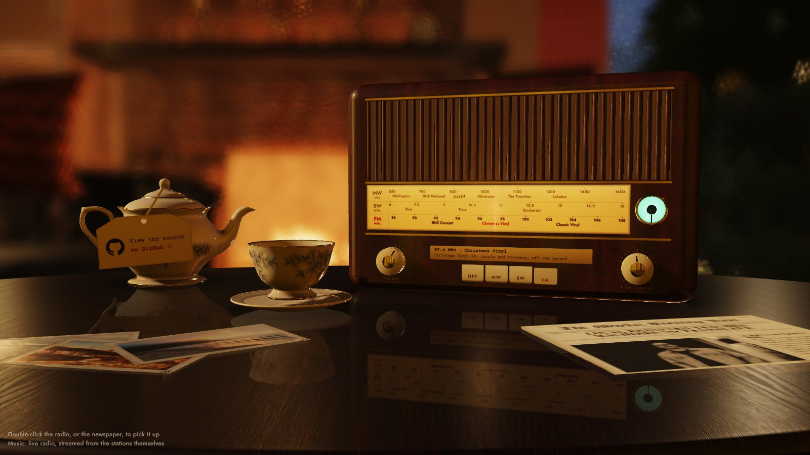

# Radio Tuner

**Live:** https://justin-cole.vercel.app (Chrome or Edge 157+)



A 1950s valve radio on a coffee table by the fire, in the browser. Its dial, station plate, piano keys and knobs are real HTML drawn onto a WebGL radio with **HTML-in-Canvas**, and they're built with **ui-sdk**, so people (mouse, keyboard, screen reader) and AI agents can all use them.

- **Dial and controls are live HTML.** The text selects, the knobs take the keyboard, and a screen reader can read the dial, even when the radio is turned upside down. Each frame, the browser is told exactly where every panel landed in 3D (a full perspective matrix), so clicks and focus follow the drawing.
- **Every station is on air, live:** the music is real radio streamed as you tune: RNZ National and RNZ Concert on their Auckland frequencies, NPO Klassiek from Hilversum, Jazz24, KPOA from Maui, 1920s dance bands, opera from Bucharest, and Christmas and classic vinyl. A stream only connects while you're tuned near it. The radio adds its own coastal forecast, Morse and time pips, and tuning between stations gives you hiss, a heterodyne whistle and static that tears the dial glass.
- **Agent-ready.** A ui-sdk agent bridge (`window.agent`) exposes the radio's controls, including a custom **Station** primitive that tunes by name and reports what's playing. WebMCP tools are registered when the browser supports them. An agent switching the radio off has to be confirmed by the person.

## Run it

Needs Chrome or Edge 157 or later (HTML-in-Canvas) and Node 22+.

```bash
pnpm install
pnpm dev
```

Double-click the radio to pick it up, drag to turn it over, scroll to bring it closer. Double-click the room (or press Escape) to put it down.

Try the agent bridge from the console:

```js
await agent.query({ within: "Station", text: "jazz" })
await agent.act({ steps: [{ ref: "Station", action: "setValue", args: ["RNZ Concert"] }] })
```

## How it's put together

| Path | What's there |
| --- | --- |
| `src/gl/stage.ts` | WebGL renderer: HTML-in-Canvas panel textures and hit-test geometry, picking up and setting down, the lamp's shadow map, tabletop reflections |
| `src/gl/radio.vert`, `src/gl/radio.frag` | One shader for everything: PBR with an HDRI, lacquer clear coat, the backlit dial, the room's materials, fire, snow |
| `src/gl/room.ts`, `src/gl/gltf.ts` | The living room, built from CC0 scans, and a small glTF loader |
| `src/ui/panels.tsx`, `src/ui/station.ts` | The HTML panels and the Station primitive |
| `src/radio/` | Stations, the audio engine and the radio's state |
| `src/ai/ui-agent.ts` | The ui-sdk agent bridge and WebMCP registration |
| `scripts/` | Asset fetchers (models and textures from Poly Haven) and Playwright checks, including `live-probe.mjs`, which tests a stream plays through Web Audio |

## Credits

- Textures, HDRI and models: [Poly Haven](https://polyhaven.com), CC0. See `public/tex/CREDITS.md` and `public/models/CREDITS.md`.
- Typewriter: ["Typewriter"](https://sketchfab.com/3d-models/typewriter-4954fbf220d748ecbd82005f31d29f15) by [landout](https://sketchfab.com/landout), [CC BY 4.0](http://creativecommons.org/licenses/by/4.0/).
- Radio: live streams from RNZ, NPO Klassiek, Jazz24 (KNKX), KPOA, Positively 1920's, Clasic Radio Opera and WALM Christmas/Classic Vinyl HD, played from their own public streams. All rights remain with the stations.
